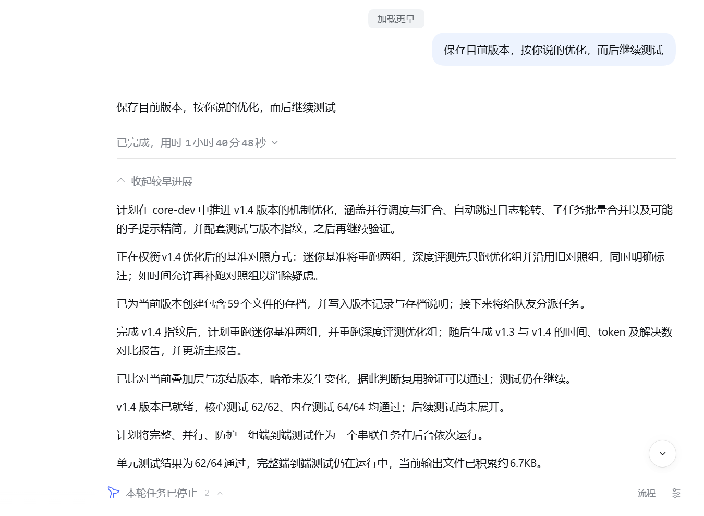
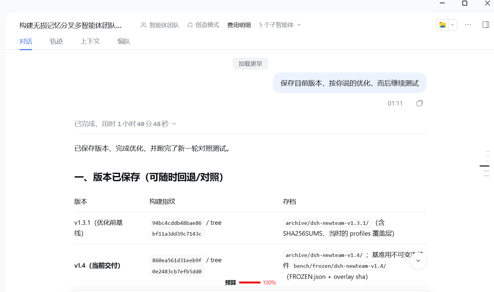
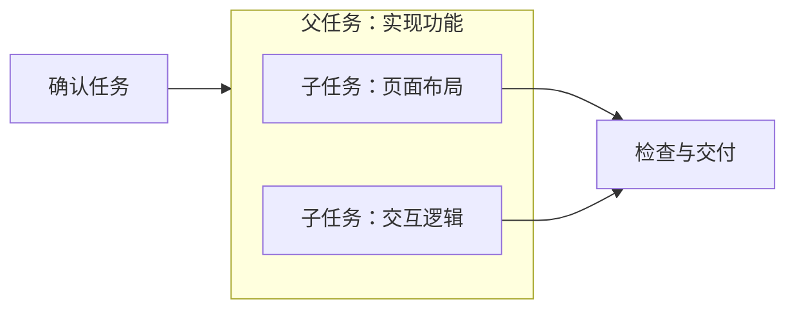

# dsh-jev-thinkout

[](https://github.com/Han-1413141/dsh-jev-thinkout/actions/workflows/ci.yml)
[](https://github.com/Han-1413141/dsh-jev-thinkout/releases)
[](https://www.npmjs.com/package/dsh-jev-progress)
[](LICENSE)

**JeV 思维链外显，让 DeepSeek 的任务进展看得见。**

DeepSeek 持续思考时，也能在聊天中看到它正在规划什么、推进到哪里、有哪些阶段结果。dsh-jev-thinkout 为 DeepSeek Harness（DSH）提供 **JeV 思维链外显**：从模型思考中筛选任务信息，概括为自然的进度、规划和小结，穿插在对应工作步骤附近。

JeV 负责识别值得展示的内容，正文可选择轻量摘要或 DSH 原生翻译。输出保留任务进程和关键结论，过滤重复计划与琐碎细节；主模型上下文保持不变。任务流程图进一步展示父子任务、串行递进与并行分支。

这是社区插件。仓库名为 `dsh-jev-thinkout`，npm 包名及插件标识为 `dsh-jev-progress`。

## 效果对照

左图为安装插件后，右图为未安装插件时的 DSH。同一任务的两种效果对比如下，可点击查看原图。

| 安装插件后：思考中的任务进展可见 | 未安装插件：DSH 原生界面 |
| --- | --- |
|  |  |

安装后，JeV 会把长思考中的任务规划、执行进展和阶段小结呈现为聊天正文，便于随时跟进和回看。摘要可使用无标识正文样式，输出频率、筛选严格程度和流程方向均可在设置中调整。

## 安装

当前版本 **0.5.5**。支持 DSH `>=0.2.1-rc.2 <0.3.0`，已在桌面端 `0.2.1-rc.2` 接入；当前进度观察针对 DeepSeek Flash，实测模型为 V4.1 Flash 1017。需要 DSH 原生翻译服务。

通过 npm 安装：

```powershell
dsh plugin --profile desktop add dsh-jev-progress@0.5.5
```

也可以使用 GitHub Release 安装包：

```powershell
dsh plugin --profile desktop add "https://github.com/Han-1413141/dsh-jev-thinkout/releases/download/v0.5.5/dsh-jev-thinkout-0.5.5.tgz"
```

安装后重新打开 DSH，在插件列表中确认 `dsh-jev-progress` 已启用。使用其他 profile 时，替换命令中的 `desktop`；找不到 `dsh` 命令时，使用安装目录内的 `resources/runtime/cli/bin/dsh.cmd`。详细步骤见[使用指南](docs/user-guide.md)。

## 三步开始使用

1. 打开 [JeV 官网](https://decision.vllm-sr.ai/)，通过 **Get API key** 获取并保存自己的 Key。
2. 在本插件详情页，或输入框上方的「进度设置」中，粘贴 Key 并点击「验证并导入」。
3. 在支持的 Flash 会话中开始任务，查看聊天摘要；点击「流程」查看任务结构。

截至 2026-10-21，JeV 官方文档将该 API 标为免费服务，仍有请求与 Token 额度限制，以[官方说明](https://decision.vllm-sr.ai/docs)为准。轻量摘要另外调用 DeepSeek Flash，可能产生费用。

## 功能

| 功能 | 使用方式 |
| --- | --- |
| 任务进度与独立摘要 | 普通进度集中为一条状态，规划和阶段小结穿插在对应工作步骤附近 |
| 两种摘要方式 | 在「进度设置 → 摘要方式」选择轻量摘要或原生翻译 |
| 父子任务流程 | 父框包含工作项，点击节点查看历史；大任务可以折叠 |
| 横向与竖向 | 在流程窗口顶部，或「进度设置 → 流程方向」切换，按会话保存 |
| 并行与串行 | 已记录的依赖用箭头递进，并行工作在同层分组；缺少关系时单独归组 |
| 输出频率与筛选 | 选择较少、适中、较多，以及宽松、均衡、严格；也可调整具体阈值 |
| 外观 | 蓝色动态鲸尾、动态思考、原生思考标签或纯文字；摘要可选无标识正文 |
| 用量与费用 | 聊天设置查看本会话，插件详情查看本机汇总；支持兼容版 cost-meter 辅助记账 |

流程结构示意如下，使用示例关系，并非运行截图：



输出根据具体新信息产生，不按固定秒数硬输出。重复计划、计算、坐标和样式细节会被过滤。切换流程方向只改变排列，不重新调用模型或生成摘要。

## 费用与数据

- JeV 与轻量摘要分别记录请求次数、Token 和成功、失败、取消；未知费用保留为未知。
- 金额为目录估算时明确标注，不等同于账户实扣。原生翻译方式不调用轻量摘要模型。
- 插件自己的用量记录可独立使用。统一记账需要 dsh-cost-meter 提供兼容接口，见 [cost-meter 适配说明及可选补丁](integrations/dsh-cost-meter/README.md)。
- Key 保存在本机凭据服务，Windows 必要时使用 DPAPI 加密。Key、会话日志与本机账本不进入仓库和安装包；上方对照截图由使用者提供并授权公开。
- 筛选和摘要会调用外部服务；自动过滤常见凭据不等于完全识别所有敏感内容。具体数据去向见[使用指南](docs/user-guide.md#数据去向)。

「已报告完成」表示存在明确的完成陈述，不等于独立验证通过。插件不修改主模型的任务清单，也不把普通工具成功当作整项任务完成。

## 文档

- [使用指南](docs/user-guide.md)：安装、Key、设置、流程阅读、费用、常见问题、更新与卸载。
- [实现说明](docs/architecture.md)：事件处理、上下文隔离、摘要、流程和辅助记账。
- [开发与发布](docs/development.md)：构建、检查、本地接入和发布步骤。
- [cost-meter 兼容说明](integrations/dsh-cost-meter/README.md)：所需接口、补丁基线和适配方法。
- [更新记录](CHANGELOG.md)与[第三方来源](THIRD_PARTY_NOTICES.md)。
- [发布与市场收录](https://github.com/Han-1413141/dsh-jev-thinkout/blob/main/MARKETPLACES.md)：npm、GitHub Release、各渠道申请链接及审核状态。

## 开发

```powershell
npm ci --ignore-scripts
npm test
npm run build
npm run check:release
```

无额外 npm 运行依赖。自动化检查不需要 Key，也不调用外部模型；前端源码位于 `web/`，构建结果为 `lib/client.js`。当前业务检查覆盖 100 项；界面仍需要在实际 DSH 窗口确认，检查通过不代表所有宿主版本已完成视觉验收。

通过 [Issues](https://github.com/Han-1413141/dsh-jev-thinkout/issues) 反馈问题，请提供版本、摘要方式、错误码及复现步骤，并去除凭据和私人会话内容。

## 许可

本项目采用 [MIT](LICENSE) 许可。DSH 原生图标与鲸尾动画保留上游 MIT 声明，详见 [THIRD_PARTY_NOTICES.md](THIRD_PARTY_NOTICES.md)。
