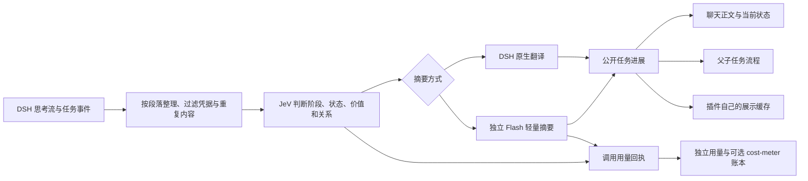

# 实现说明

## 处理过程

目标是展示工作概况：任务计划、正在推进的环节、阶段结果、变化和阻碍。输出不是逐句翻译思考，也不公开计算过程、代码或内部争论。

## 模块

| 文件 | 职责 |
| --- | --- |
| `src/host.js` | 宿主事件接入、会话隔离、配置与 owner 侧 RPC |
| `src/pipeline.js` | 流式段落、候选队列、取消、双模式与状态恢复 |
| `src/summary-classify.js` | JeV 问题、受限上下文与关系选择 |
| `src/narrator.js` | 独立轻量请求，不携带主会话消息列表 |
| `src/progress-reports.js` | 普通进度合并、独立摘要与公开内容去重 |
| `src/key-manager.js` | 验证 Key、原生凭据与 Windows DPAPI 回退 |
| `src/light-usage.js` | Token、结果状态及目录费用估算 |
| `src/cost-integration.js` | 辅助记账协议、持久队列、重连与去重 |
| `src/state-store.js` | 有界展示缓存，独立于主会话日志 |
| `web/chat.js` | 来源位置关联、标准模式分组与正文显示 |
| `web/flow-model.js` | 任务 → 工作项 → 历史的投影与依赖层 |
| `web/flow.js` | 横竖布局、详情、折叠、缩放与拖动 |
| `web/canvas.js` | 进度入口、设置、用量和连接界面 |

## 上下文与取消

主模型上下文不变。轻量摘要通过独立调用完成，不携带主会话 ID、工具或原消息列表。发送给辅助服务的文字受长度和候选范围限制，已发布摘要进入去重参考。

切换摘要方式、重新发起尝试或中断执行时，旧结果不能覆盖新状态。同一长思考中的多个独立小结可以并发完成；展示顺序按来源位置，普通状态仍在原位更新。

## 流程关系

视图把相同任务下的相同工作项归在一起，保留对应历史。任务归属来自已有标识；缺少可靠归属的旧记录按阶段单独归组。

串行依赖形成逻辑层，并行项目共享一层。横向、竖向使用同一份层次数据；切换只改变排列方向。冲突关系标为待确认，防止环把布局推到远处。跨父任务的局部依赖保留具体工作项信息，不扩大成整项任务必须全部结束。

流程关闭时不计算布局；记录未变化时不重建界面。拖动每帧只更新滚动位置；连线在内容、折叠、方向或尺寸变化后合并更新。详情按需加载到侧栏，大量历史不变成大量微小节点。

## 费用与降级

JeV 和轻量调用各自记录真实请求 ID、用途、时间、模型、用量及结果。调用失败或取消后，已返回的用量仍保留；未知项不补零。

cost-meter 适配通过宿主服务写入，不向客户端开放记账写入 API。轻量模型流使用独立标记避开原全局计费钩子，再提交一次辅助回执。队列持久化；重启恢复、重复提交与历史回放都使用请求 ID 去重。协议见 [兼容说明](../integrations/dsh-cost-meter/README.md)。

缺少兼容 cost-meter 时，插件自己的用量界面继续工作。JeV 或翻译服务暂时不可用时，不把失败转换成虚构的任务进展。
